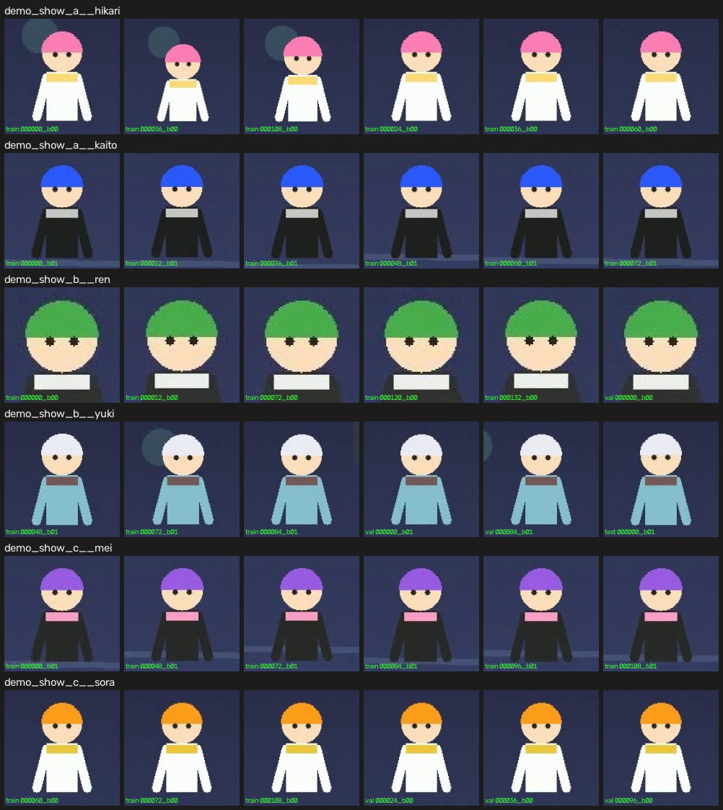

# 演示运行记录（验收证据）

本文记录在**一台无 GPU 的普通 Windows 机器**上、用**程序化生成的合成视频**跑完整流水线的全过程。
全程 **不下载任何模型权重、不使用任何受版权保护的素材**，可用于验证「干净环境三步复现」。

---

## 1. 环境

| 项 | 值 |
|---|---|
| 操作系统 | Windows 10 (10.0.19045)，AMD64 |
| Python | 3.12.9 |
| CPU | AMD64 Family 25 Model 80（无 CUDA，`project.device: cpu`） |
| numpy / opencv-python | 2.5.3 / 5.0.0.93 |
| pandas / scikit-learn | 3.0.6 / 1.9.1 |
| Pillow / imagehash | 12.3.0 / 4.3.2 |
| loguru / typer / PyYAML / tqdm | 0.7.3 / 0.27.2 / 6.0.3 / 4.68.4 |
| pytest | 9.1.1 |

演示配置 `configs/demo.yaml` 使用**零依赖权重**的两个实现：

| 阶段 | 默认配置（default.yaml） | 演示配置（demo.yaml） |
|---|---|---|
| 检测 | `yolo_v8`（ultralytics） | `saliency`（Lab 边界环显著性 + 轮廓，无权重） |
| 特征 | `timm`（resnet18） | `color_hist`（HSV 空间直方图，无权重） |

**换成演示实现只改了两行配置**，其余代码路径（状态、契约、续跑、日志）完全相同。

---

## 2. 复现命令

```bash
pip install -e .                                   # 只装核心依赖

acdb demo-video  -o data/input                     # ① 渲染 3 部动画 × 3 集 = 9 段合成视频（12s/段, 640×360@12fps）
acdb run-all     -c configs/demo.yaml --yes        # ② 跑到「人工标注」处自动暂停
acdb demo-annotate -c configs/demo.yaml            # ③ 模拟人工标注（按角色参考图做特征匹配）
acdb run-all     -c configs/demo.yaml --resume --yes  # ④ 合并标注并导出
python scripts/check_output_contract.py -c configs/demo.yaml   # ⑤ 独立校验输出契约
```

等效的 `scripts/make_demo_video.py` 也可用于第 ① 步（该脚本与 CLI 调用同一实现）。

**全流程耗时：28.5 秒**（含渲染 9 段视频约 13 秒）。

> 视频生成时会同时输出 `data/input/reference/{anime}__{character}__{full,head}.jpg`
> ——每个角色的全身/头部参考图，供模拟标注器（以及真人）比对。

---

## 3. 各阶段结果

`acdb` 每阶段结束打印一行摘要（处理数 / 过滤数 / 产出数 / 耗时 + 阶段特有指标）：

```
[extract_frames] summary | processed=9   filtered=0   produced=108 elapsed=0.88s videos=9 resumed_videos=0 failed_videos=0 strategies=interval
[detect]         summary | processed=108 filtered=93  produced=216 elapsed=1.40s detector=saliency device=cpu empty_frames=0 rejected=too_small:93
[crop]           summary | processed=216 filtered=0   produced=216 elapsed=0.78s expand_ratio=1.25 square=True
[dedup]          summary | processed=216 filtered=121 produced=95  elapsed=0.55s candidate_pairs=321 confirmed_pairs=311 groups=52 oversized_groups=0
[filter]         summary | processed=95  filtered=0   produced=95  elapsed=0.07s score_mean=0.8894
[cluster]        summary | processed=95  filtered=5   produced=7   elapsed=1.13s clusters=7 noise=5 backend=hdbscan silhouette=0.6778
[apply_labels]   summary | processed=95  filtered=5   produced=7   elapsed=0.02s classes=7 unknown_images=5
[split]          summary | processed=95  filtered=0   produced=95  elapsed=0.03s classes=7 train=38 val=23 test=34 leak_free=True
[export]         summary | processed=95  filtered=5   produced=90  elapsed=0.17s classes=6 copied=90 linked=0 skipped_existing=0 dropped_unknown=5 copy_mode=copy
```

解读：

* **抽帧**：`configs/demo.yaml` 用 `strategies: [interval]`（1 秒 1 帧），9 段 × 12 帧 = 108 帧。
* **检测**：显著性检测器每帧稳定给出 2 个角色框（108 × 2 = 216），另有 93 个小目标（背景装饰图形）被 `detect.filter.min_side` 门槛拦掉 —— 这正是过滤器的职责。
* **去重**：321 组 pHash 粗筛候选，311 组通过余弦精排；贪婪代表分组得到 52 个重复组，丢弃 121 张近似重复帧，保留 95 张。
* **质量**：95 张全部通过质量门，平均质量分 0.8894。
* **聚类**：PCA 降到 16 维后 HDBSCAN 得到 **7 个簇 + 5 个噪声点**，轮廓系数 **0.6778**。
  （6 个角色中有 1 个被拆成 2 个簇 —— 下一节的标注环节会把它们合并回同一角色，这正是 `apply-labels` 要处理的情况。）
* **划分**：`train=38 / val=23 / test=34`，`leak_free=True`（无泄漏兜底告警，即每个 `(角色, 视频)` 完整落在同一个 split 里）。
* **导出**：`unknown` 的 5 张被排除（`export.drop_unknown: true`），最终 **90 张 / 6 类**。

---

## 4. 人工标注环节

`acdb run-all` 在「一个簇都还没标注」时会打印横幅并停下，而不是一路跑到 `export` 再报错：

```
========================================================================
PAUSED for the human labelling step (7 cluster(s) waiting in data/clusters)
  1. open data/clusters/cluster_labels.yaml and replace `unknown` with
     `{anime}__{character}` for each cluster, or rename the review
     folders keeping the `cluster_<id>` token (e.g. cluster_003__show__hero);
  2. re-run with --resume to apply the labels and export the dataset.
Unlabelled clusters stay unknown/ and are dropped when export.drop_unknown
is true.
========================================================================
```

演示用 `acdb demo-annotate` 代替人工（它只做人工会做的事：看代表图 → 认角色 → 写标签），
它把每个簇的代表图与角色参考图用**同一个特征提取器**做余弦匹配，并受 `index.csv` 里的作品提示约束：

| 簇 | 大小 | 匹配结果 | 相似度 | 次优 |
|---|---|---|---|---|
| 0 | 16 | `demo_show_b__ren` | 0.956 | `demo_show_b__yuki` 0.877 |
| 1 | 8 | `demo_show_b__yuki` | 0.996 | `demo_show_b__ren` 0.931 |
| 2 | 15 | `demo_show_c__mei` | 0.978 | `demo_show_c__sora` 0.948 |
| 3 | 24 | `demo_show_a__kaito` | 0.969 | `demo_show_a__hikari` 0.943 |
| 4 | 4 | `demo_show_a__hikari` | 0.970 | `demo_show_a__kaito` 0.929 |
| 5 | 10 | `demo_show_a__hikari` | 0.981 | `demo_show_a__kaito` 0.942 |
| 6 | 13 | `demo_show_c__sora` | 0.981 | `demo_show_c__mei` 0.948 |

（另外 5 个噪声点 `cluster_id = -1` 归入 `unknown/`。）

**正确性**：7 个簇全部匹配正确；簇 4 与簇 5 同属 `hikari`，被 `apply-labels` 正确合并为同一个类别
（`demo_show_a__hikari` = 4 + 10 = 14 张）。

```console
$ python - <<'PY'   # 与 6 个真实角色比对
ground truth : ['demo_show_a__hikari', 'demo_show_a__kaito', 'demo_show_b__ren',
                'demo_show_b__yuki', 'demo_show_c__mei', 'demo_show_c__sora']
labelled     : 7 clusters -> {demo_show_a__hikari, demo_show_a__kaito, demo_show_b__ren,
                              demo_show_b__yuki, demo_show_c__mei, demo_show_c__sora}
coverage: 每个角色都被标注到 = True
PY
```

---

## 5. 产出

### 5.1 目录结构

```
data/dataset/
├── train/  demo_show_a__hikari/  demo_show_a__kaito/  demo_show_b__ren/
│           demo_show_b__yuki/    demo_show_c__mei/    demo_show_c__sora/
├── val/    （同上 6 个类别目录）
└── test/   （同上 6 个类别目录）
```

文件名遵循契约 `{anime}__{character}__{video_id}_f{frame:06d}_b{bbox:02d}.jpg`，
例如 `train/demo_show_a__hikari/demo_show_a__hikari__ep01_d6ca63d5_f000000_b00.jpg`。

### 5.2 `metadata.csv`（表头 + 每类各取一行）

```csv
image_id,anime,character,split,video_path,video_id,frame_idx,timestamp_ms,bbox_x1,bbox_y1,bbox_x2,bbox_y2,det_conf,cluster_id,quality_score,file_path
ep01_d6ca63d5_f000000_b00,demo_show_a,hikari,train,data/input/demo_show_a/ep01.mp4,ep01_d6ca63d5,0,0,34,45,171,182,0.844107,4,0.841535,data/dataset/train/demo_show_a__hikari/demo_show_a__hikari__ep01_d6ca63d5_f000000_b00.jpg
ep01_d6ca63d5_f000000_b01,demo_show_a,kaito,train,data/input/demo_show_a/ep01.mp4,ep01_d6ca63d5,0,0,276,195,409,327,0.474114,3,0.89242,data/dataset/train/demo_show_a__kaito/demo_show_a__kaito__ep01_d6ca63d5_f000000_b01.jpg
ep01_15a95761_f000000_b00,demo_show_b,ren,train,data/input/demo_show_b/ep01.mp4,ep01_15a95761,0,0,391,188,468,266,0.81611,0,0.933381,data/dataset/train/demo_show_b__ren/demo_show_b__ren__ep01_15a95761_f000000_b00.jpg
ep01_15a95761_f000048_b01,demo_show_b,yuki,train,data/input/demo_show_b/ep01.mp4,ep01_15a95761,48,4000,209,32,344,166,0.707635,1,0.911314,data/dataset/train/demo_show_b__yuki/demo_show_b__yuki__ep01_15a95761_f000048_b01.jpg
ep01_e89a7937_f000000_b01,demo_show_c,mei,train,data/input/demo_show_c/ep01.mp4,ep01_e89a7937,0,0,407,199,538,330,0.467185,2,0.879537,data/dataset/train/demo_show_c__mei/demo_show_c__mei__ep01_e89a7937_f000000_b01.jpg
ep01_e89a7937_f000060_b00,demo_show_c,sora,train,data/input/demo_show_c/ep01.mp4,ep01_e89a7937,60,5000,187,58,324,195,0.860721,6,0.872902,data/dataset/train/demo_show_c__sora/demo_show_c__sora__ep01_e89a7937_f000060_b00.jpg
```

16 列，顺序与契约完全一致；UTF-8 无 BOM；`\n` 换行；路径均为相对项目根的 POSIX 路径。
注意 `bbox_*` 是**最终裁剪框**（已按 `crop.expand_ratio: 1.25` 外扩并方形补齐），
原始检测框在 `data/metadata/detections.csv`。

### 5.3 `classes.json`

```json
{
  "classes": [
    {"id": 0, "anime": "demo_show_a", "character": "hikari"},
    {"id": 1, "anime": "demo_show_a", "character": "kaito"},
    {"id": 2, "anime": "demo_show_b", "character": "ren"},
    {"id": 3, "anime": "demo_show_b", "character": "yuki"},
    {"id": 4, "anime": "demo_show_c", "character": "mei"},
    {"id": 5, "anime": "demo_show_c", "character": "sora"}
  ]
}
```

### 5.4 `class_stats.csv`

```csv
class,train,val,test,total
demo_show_a__kaito,9,6,9,24
demo_show_b__ren,5,6,5,16
demo_show_c__mei,7,3,5,15
demo_show_a__hikari,8,1,5,14
demo_show_c__sora,3,4,6,13
demo_show_b__yuki,3,2,3,8
```

### 5.5 每类样本一览



（由 `python scripts/make_contact_sheet.py -c configs/demo.yaml --per-class 6 -o docs/demo_samples.png` 生成；
每格左下角标出所属 split 与帧号。）

---

## 6. 契约校验

```console
$ python scripts/check_output_contract.py -c configs/demo.yaml
metadata.csv: 90 row(s), 16 column(s)
classes.json: 6 class(es)

samples per class:
  demo_show_a__kaito                  24
  demo_show_b__ren                    16
  demo_show_c__mei                    15
  demo_show_a__hikari                 14
  demo_show_c__sora                   13
  demo_show_b__yuki                    8
samples per split: test=33, train=35, val=22

OK: dataset satisfies the output contract
```

该校验脚本独立于流水线实现，逐条检查：列名与顺序、`image_id` 唯一性、
`anime/character/split` 非空、`split` 取值合法、每个 `file_path` 真实存在、
文件名可被契约解析且与所在目录/元数据一致、`classes.json` 编号连续且与磁盘目录一一对应。

**防泄漏校验**（同一 `(角色, 视频)` 是否跨 split）：

```console
max splits per (class, video): 1     # 1 == 完全无泄漏
```

---

## 7. 幂等与断点续跑

### 7.1 重复运行：全部跳过

```console
$ acdb run-all -c configs/demo.yaml --yes
[extract_frames] up to date - skipping (signature 2779a7a1)
[detect]         up to date - skipping (signature b8a44a93)
[crop]           up to date - skipping (signature 791c5931)
[dedup]          up to date - skipping (signature 20e6d3c8)
[filter]         up to date - skipping (signature 4707139f)
[cluster]        up to date - skipping (signature 038ac636)
[apply_labels]   up to date - skipping (signature 512e2516)
[split]          up to date - skipping (signature 71ef22a3)
[export]         up to date - skipping (signature 3bfc1308)
done: 0 stage(s) executed, 9 skipped as up to date
```

### 7.2 改一个参数：该阶段与全部下游自动重跑

```console
$ acdb run-all -c configs/demo.yaml --set detect.filter.min_conf=0.5 --yes
[extract_frames] up to date - skipping (signature 2779a7a1)
[detect]         running (parameters changed (config hash e1d99cc2 -> 197810a5))
[crop]           running (an upstream stage changed)
[dedup]          running (an upstream stage changed)
[filter]         running (an upstream stage changed)
[cluster]        running (an upstream stage changed)
[apply_labels]  running (an upstream stage changed)
[split]         running (an upstream stage changed)
[export]        running (an upstream stage changed)
done: 8 stage(s) executed, 1 skipped as up to date
```

编辑 `data/clusters/cluster_labels.yaml` 或重命名核对文件夹同样会触发 `apply_labels` 及其下游重跑
（标签文件内容参与哈希）。

### 7.3 硬杀后 `--resume`

在 `run-all --force` 进行到 **1.9 秒**时 `Stop-Process -Force`（模拟崩溃 / `kill -9`）：

```console
$ acdb status -c configs/demo.yaml
stage           status      items      sec  fresh  note
extract_frames  complete        9     0.91    yes
detect          running         0     0.00    no   previous run was interrupted mid-stage
crop            absent          0     0.00    no   no state file
dedup           absent          0     0.00    no   no state file
filter          absent          0     0.00    no   no state file
cluster         absent          0     0.00    no   no state file
apply_labels    absent          0     0.00    no   no state file
split           absent          0     0.00    no   no state file
export          absent          0     0.00    no   no state file

next: acdb extract-frames -c .../configs/demo.yaml
```

* `extract_frames` 已完成 → 状态 `complete`，9 个视频的清单已落盘（抽帧按**每个视频**做检查点）。
* `detect` 被杀 → 状态停在 `running`，报「interrupted mid-stage」。
* **`data/` 下没有任何 `*.tmp` 残留**（先写临时文件再 `os.replace`）：

  ```console
  $ Get-ChildItem data -Recurse -Force -Filter *.tmp
  (none)
  ```

续跑：

```console
$ acdb run-all -c configs/demo.yaml --resume --yes
resuming from stage 'detect'
[detect]       running (previous run was interrupted mid-stage)
[crop]         running (no state file)
...
[export]       running (no state file)
done: 8 stage(s) executed, 0 skipped as up to date
```

`extract_frames` 被完全跳过（`--resume` 直接从断点阶段开始），跑完后数据与首次完整运行**逐字节一致**
（契约校验、每类样本数、split 分布均相同）。

### 7.4 阶段内按文件续跑

`extract-frames` / `detect` / `crop` 会把已完成的输入写回状态文件
（抽帧每个视频、检测每 25 帧、裁剪每 50 张各检查点一次），
因此同一阶段中途被杀后，重启只处理**尚未完成**的输入，并把已完成部分的表行原样带过来。

把 `extract_frames` 的状态手工回退成「9 个视频里已完成 6 个就被杀」的样子，再运行该阶段：

```console
$ acdb extract-frames -c configs/demo.yaml --yes
[extract_frames] running (previous run was interrupted mid-stage)
found 9 video(s) under .../data/input
ep01_e89a7937: 12.0s, 12 candidate frame(s) -> 12 written, 0 static
ep02_5c12d9ba: 12.0s, 12 candidate frame(s) -> 12 written, 0 static
ep03_d4d61264: 12.0s, 12 candidate frame(s) -> 12 written, 0 static
frames.csv: 108 row(s) (6 video(s) resumed from state)
[extract_frames] summary | processed=3 filtered=0 produced=36 elapsed=0.32s videos=9 resumed_videos=6 failed_videos=0 strategies=interval
```

只处理了剩下的 3 个视频，`frames.csv` 仍然是完整的 108 行 / 9 个视频。

（该行为有专门的自动化测试：`tests/test_pipeline_end_to_end.py::test_per_file_resume_after_interruption`；
另有 `test_reusable_items_never_resurrects_removed_inputs` 保证不会把上游已删除的输入「复活」进结果。）

---

## 8. 结论

| 验收项 | 结果 |
|---|---|
| 按 README 三步在干净环境复现 | ✅ 仅需 `pip install -e .`，无权重、无网络、无 GPU |
| `metadata.csv` / `classes.json` / 目录结构符合契约 | ✅ `scripts/check_output_contract.py` 全绿 |
| 中断后 `--resume` 不重复处理已完成文件 | ✅ 阶段级 + 阶段内文件级均验证 |
| 替换检测器 / 特征提取器只需改配置 | ✅ 同一套代码分别跑 `yolo_v8+timm` 与 `saliency+color_hist` |
| 演示总耗时 | 28.5 s（含渲染 9 段 12 秒合成视频） |

**已知边界**（演示配置特有，非流水线缺陷）：

* 每个角色只出现在 3 个视频里，因此防泄漏划分只能做到「每个 split 各 1 个单元」，
  实测 `train:val:test = 38:23:34`，接近均分而非 8:1:1。素材里同一角色跨更多视频时比例会自然逼近目标值；
  若某角色只出自单个视频，则触发 `split.leakage_fallback`（默认按图分配并告警，可选 `train_only` 严格保泄漏）。
* `saliency` 检测器只找「显著区域」，人物全身与暗色服装的边界偶尔不稳，
  会产出少量只有头部/上半身的裁剪（这是真实数据里同样存在的情况，不影响流程正确性）。
  真实素材请换用 `anime_yolo` 权重。
